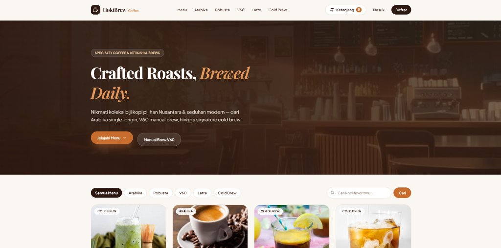
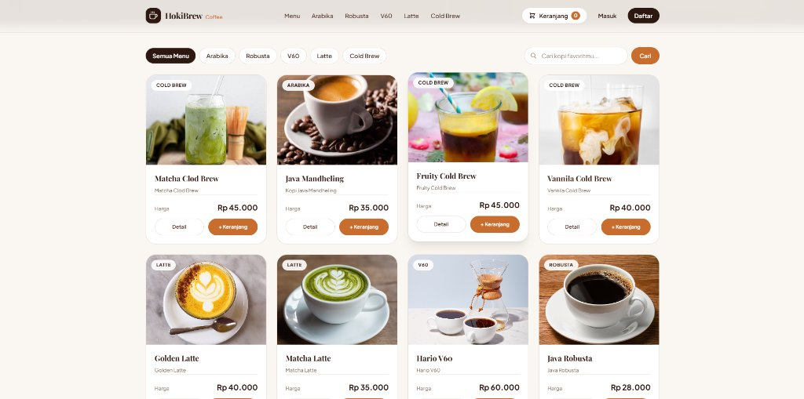
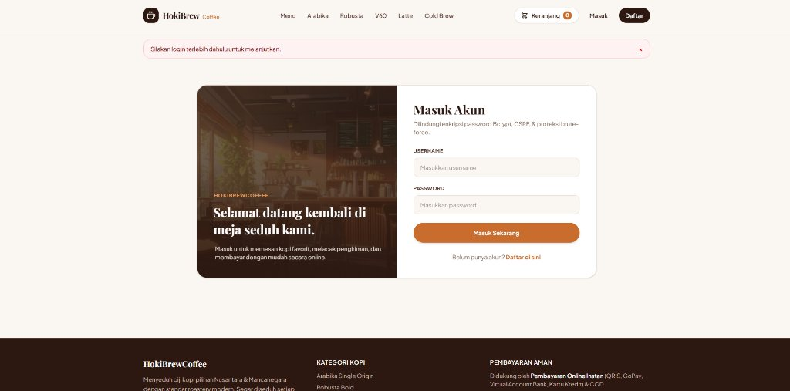
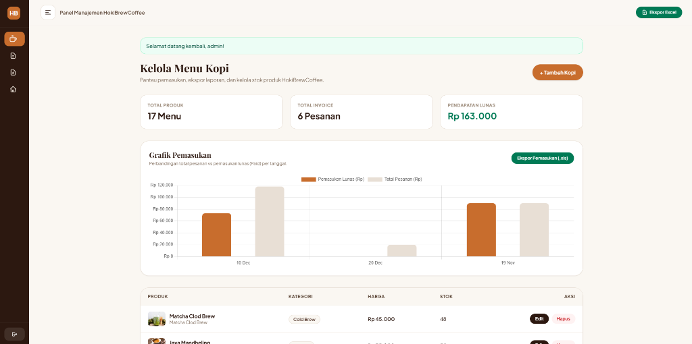
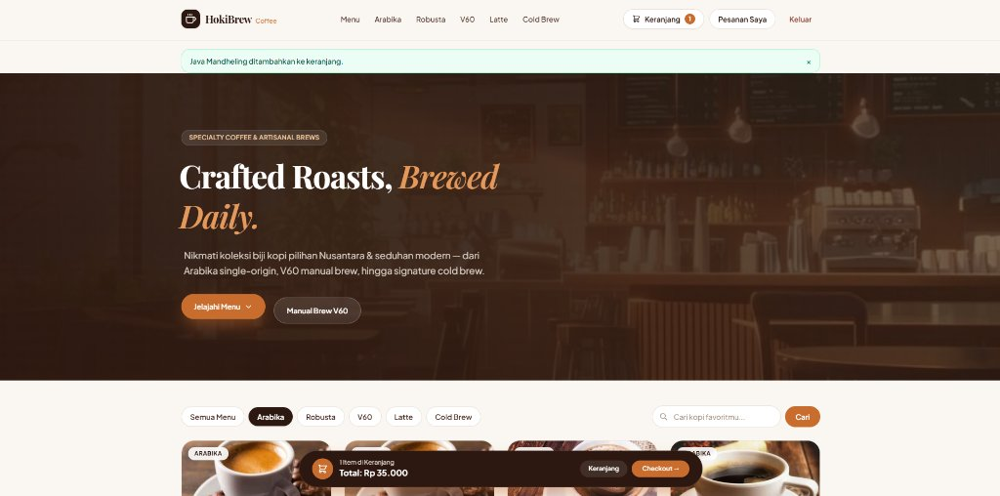
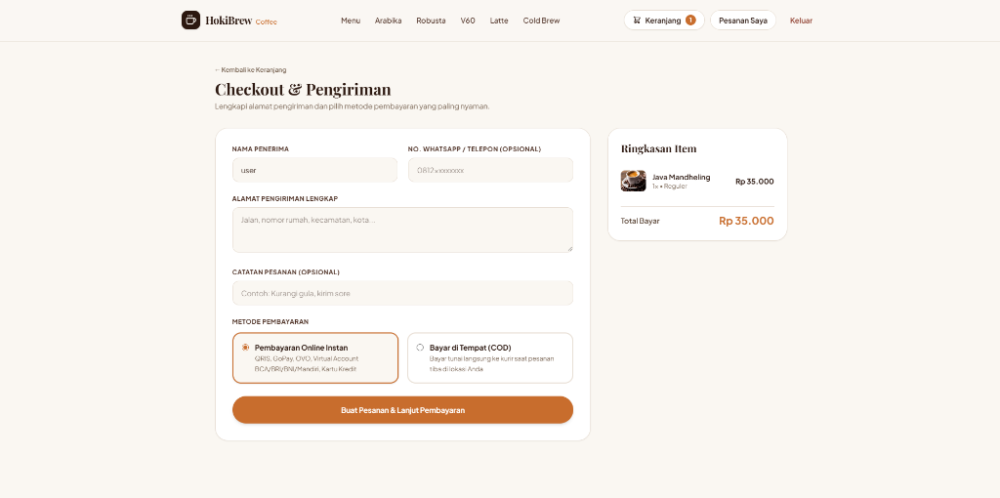
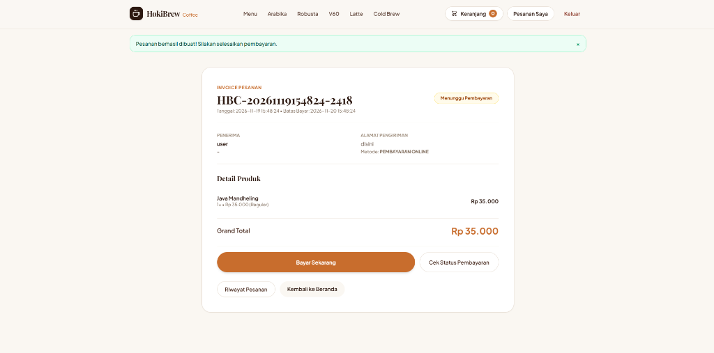
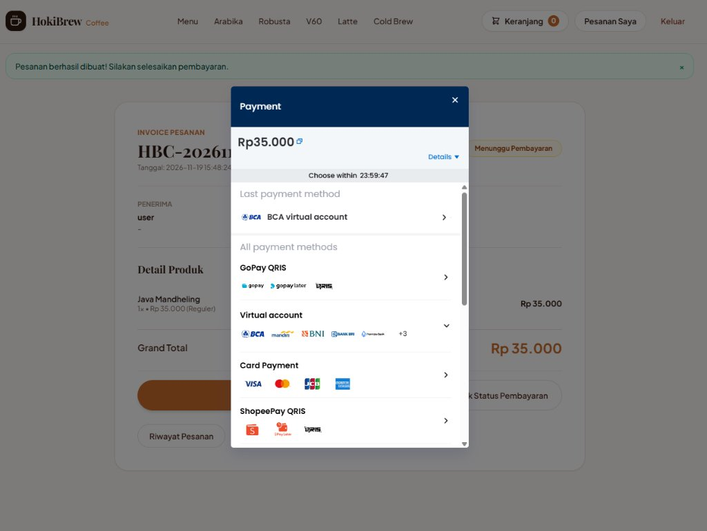
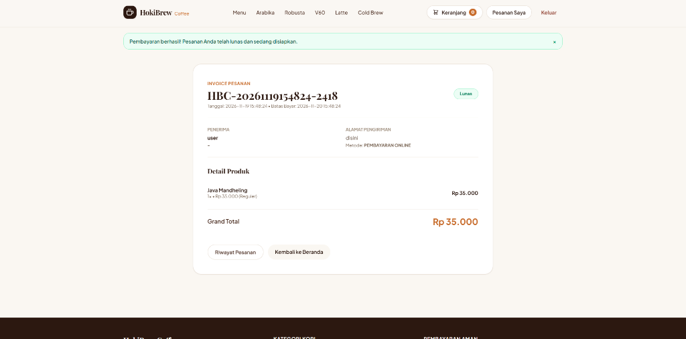
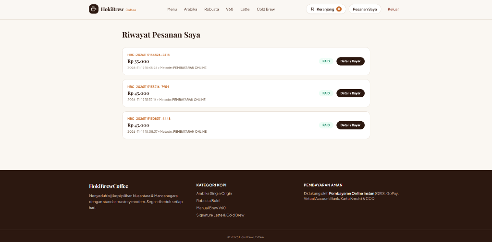

# HokiBrewCoffee

**HokiBrewCoffee** adalah aplikasi web e-commerce kedai kopi & roastery modern berbasis **CodeIgniter 4** dan **Tailwind CSS v4**, dilengkapi sistem autentikasi yang diperkuat, integrasi pembayaran online (**Midtrans Snap**), serta panel admin dengan grafik pemasukan, cetak struk, dan ekspor laporan Excel.

---

## Fitur & Dokumentasi Fungsi

### 1. Etalase & Pemesanan Pelanggan
- **Katalog & Filter Menu** (`HomeController`):
  - Menampilkan daftar produk kopi dari `tb_kopi` lengkap dengan filter kategori (`Arabika`, `Robusta`, `V60`, `Latte`, `Cold Brew`) dan pencarian kata kunci (`?q=...`).
- **Detail Produk** (`HomeController::detail`):
  - Menampilkan deskripsi, harga, stok tersedia, pilihan penyajian/gilingan (*Hot / Iced / Whole Bean / Ground*), serta rekomendasi kopi serupa.
- **Keranjang Belanja & Floating Cart Bar** (`CartController`):
  - Menyimpan item di session (`tambah`, `update` tambah/kurang/hapus item, dan `hapus` seluruh keranjang) dengan validasi stok.
  - **Floating Bottom Cart Bar** otomatis muncul di bagian bawah halaman toko saat keranjang terisi untuk menjembatani ke halaman keranjang/checkout.
- **Checkout & Pembayaran** (`CheckoutController`):
  - Mendukung dua metode: **Pembayaran Online Instan** (QRIS, e-Wallet, Virtual Account, Kartu) dan **Bayar di Tempat (COD)**. Nomor telepon bersifat opsional.
  - Menggunakan transaksi database (`transStart` / `transComplete`) untuk membuat invoice (`tb_invoice`), menyimpan item pesanan (`tb_pesanan`), dan mengurangi stok produk secara atomik.
- **Riwayat Pesanan** (`CheckoutController::orders`):
  - Pelanggan dapat memantau seluruh pesanan dan status pembayarannya di `/pesanan`.

### 2. Integrasi Pembayaran Online & Webhook
- **Midtrans Snap** (`CheckoutController::process`, `payment`, `finish`):
  - Menghasilkan `snap_token` dan menimpa (*override*) `callbacks.finish` agar kembali ke `/checkout/finish`.
  - `syncMidtransStatus()` memverifikasi status transaksi langsung ke API Midtrans (`\Midtrans\Transaction::status()`) secara otomatis saat halaman `/checkout/finish` maupun `/checkout/bayar/{orderId}` dibuka.
- **Webhook Notifikasi** (`MidtransController::notification`):
  - Endpoint `POST /midtrans/notification` (dikecualikan dari CSRF filter) memverifikasi `signature_key` SHA-512 dari Midtrans sebelum memperbarui status `paid`, `pending`, `expired`, atau `failed`.

### 3. Keamanan & Autentikasi
- **Password Hashing**: Seluruh password di-hash menggunakan `PASSWORD_BCRYPT` dan diverifikasi dengan `password_verify()` (`AuthController`).
- **Proteksi Brute-Force**: Rate limiting berbasis IP (`Services::throttler()`) serta penguncian akun selama 15 menit setelah 5 kali percobaan login gagal (`login_attempts`, `locked_until` pada `tb_user`).
- **Session & Role Guard**: Regenerasi session ID saat login (`session()->regenerate(true)`), proteksi CSRF global, `secureheaders`, dan filter rute eksplisit (`AuthFilter`, `AdminFilter`, `GuestFilter`) dengan `$routes->setAutoRoute(false)`.

### 4. Panel Admin (`Admin\KopiController` & `Admin\InvoiceController`)
- **Sidebar Collapsible & Responsif**: Dapat dibuka/tutup di desktop maupun mobile.
- **Manajemen Menu Kopi**: Tambah (modal pop-up dengan validasi gambar maks 2MB), edit dengan *live image preview*, hapus, dan **pagination** (6 item per halaman).
- **Grafik Pemasukan**: Visualisasi perbandingan pemasukan lunas (*paid*) vs total pesanan per tanggal menggunakan Chart.js.
- **Manajemen Invoice, Cetak Struk & Ekspor Excel**:
  - Ubah status pembayaran invoice secara manual.
  - **Cetak Struk** (`/admin/invoice/struk/{id}`) dengan layout siap print (`@media print`).
  - **Ekspor Excel** (`/admin/invoice/export`) mengunduh laporan pemasukan format `.xls`.

---

## Dokumentasi Tampilan & Halaman Website

### 1. Halaman Publik & Pelanggan

| Halaman | Rute | File View | Deskripsi Tampilan & Fungsi |
| :--- | :--- | :--- | :--- |
| **Beranda / Katalog** | `/` & `/kategori/{slug}` | `app/Views/store/index.php` | Hero banner dengan gambar interior kafe, animasi teks *looping* berurutan, filter kategori (*Semua Menu, Arabika, Robusta, V60, Latte, Cold Brew*), kolom pencarian, grid kartu produk dengan animasi *scroll repeat-reset*, serta tombol **Detail** dan **+ Keranjang**. |
| **Detail Produk** | `/kopi/{id}` | `app/Views/store/detail.php` | Tampilan 2 kolom berisi foto produk, badge kategori, status stok, harga, pilihan penyajian/gilingan (*Hot, Iced, Whole Bean, Ground*), input jumlah, tombol tambah ke keranjang, serta daftar **Kopi Serupa**. |
| **Floating Cart Bar** | *(Muncul otomatis di toko)* | `app/Views/layouts/main.php` | Pop-up bar di bagian bawah layar yang tampil saat keranjang terisi (`> 0` item), menampilkan jumlah item, total harga, serta tombol pintas ke **Keranjang** dan **Checkout**. |
| **Keranjang Belanja** | `/keranjang` | `app/Views/store/cart.php` | Daftar item di keranjang dengan kontrol kuantitas (`-` / `+`), tombol **Hapus** per item, **Kosongkan Keranjang**, dan kartu **Ringkasan Pesanan** menuju checkout. |
| **Checkout & Pengiriman** | `/checkout` | `app/Views/store/checkout.php` | Form 2 kolom (data penerima, nomor telepon opsional, alamat lengkap, catatan) serta pemilih metode pembayaran (**Pembayaran Online Instan** vs **Bayar di Tempat / COD**) dengan highlight aktif dinamis dan ringkasan item *sticky*. |
| **Pembayaran & Invoice** | `/checkout/bayar/{orderId}` | `app/Views/store/payment.php` | Menampilkan Order ID, status pembayaran (*Menunggu Pembayaran / Lunas / Kedaluwarsa / Gagal*), detail penerima & item, tombol **Bayar Sekarang** (popup Midtrans Snap), dan tombol **Cek Status Pembayaran** yang otomatis menyinkronkan status ke server. |
| **Riwayat Pesanan** | `/pesanan` | `app/Views/store/orders.php` | Daftar seluruh pesanan pelanggan beserta tanggal, total bayar, metode, badge status, dan tombol **Detail / Bayar**. |

### 2. Halaman Autentikasi

| Halaman | Rute | File View | Deskripsi Tampilan & Fungsi |
| :--- | :--- | :--- | :--- |
| **Masuk (Login)** | `/login` | `app/Views/auth/login.php` | Layout split-screen: panel kiri menampilkan foto kafe dengan teks animasi *repeat loop*, panel kanan berisi form login beranimasi bertahap dengan proteksi CSRF, Bcrypt, throttling IP, dan penguncian akun otomatis. |
| **Daftar (Register)** | `/register` | `app/Views/auth/register.php` | Layout split-screen dengan form registrasi (Nama, Username unik, Email opsional, Password min. 8 karakter + konfirmasi) dan validasi server-side. |

### 3. Halaman Panel Admin

| Halaman | Rute | File View | Deskripsi Tampilan & Fungsi |
| :--- | :--- | :--- | :--- |
| **Layout & Sidebar Admin** | `/admin/*` | `app/Views/layouts/admin.php` | Sidebar gelap espresso yang dapat dibuka/tutup (*collapsible*) dengan animasi halus di desktop maupun *slide-in drawer* di mobile, dilengkapi tombol cepat **Ekspor Excel** di topbar. |
| **Dashboard & Data Kopi** | `/admin/kopi` | `app/Views/admin/kopi/index.php` | Kartu KPI (*Total Produk, Total Invoice, Pendapatan Lunas*), **Grafik Pemasukan** interaktif (Chart.js), tabel menu kopi dengan **pagination** (6 item/halaman), serta modal pop-up **Tambah Menu Kopi** dengan backdrop blur hitam. |
| **Edit Menu Kopi** | `/admin/kopi/edit/{id}` | `app/Views/admin/kopi/edit.php` | Form 2 kolom untuk mengubah detail kopi disertai kartu **Live Image Preview** yang langsung menampilkan pratinjau foto baru sebelum disimpan. |
| **Daftar Invoice** | `/admin/invoice` | `app/Views/admin/invoice/index.php` | Tabel seluruh pesanan masuk (Order ID, Pemesan, Tanggal, Total, Metode, Status) dengan tombol **Ekspor Pemasukan (.xls)**, **Detail**, dan **Cetak Struk**. |
| **Detail Invoice** | `/admin/invoice/{id}` | `app/Views/admin/invoice/detail.php` | Rincian item pesanan, data pengiriman, form ubah status pembayaran manual, serta tombol **Cetak Struk**. |
| **Struk Pembayaran** | `/admin/invoice/struk/{id}` | `app/Views/admin/invoice/receipt.php` | Tampilan struk bergaya thermal (*monospace*) siap cetak (`window.print()`) dengan CSS `@media print` yang menyembunyikan tombol navigasi saat dicetak. |

### 4. Galeri Tampilan Website

| Halaman | Preview |
| :--- | :---: |
| **Beranda & Hero Banner** |  |
| **Katalog Menu & Filter Kategori** |  |
| **Halaman Login (Split-Screen & Keamanan)** |  |
| **Dashboard Admin & Grafik Pemasukan** |  |
| **Tambah ke Keranjang & Floating Cart Bar** |  |
| **Checkout & Pemilihan Metode Pembayaran** |  |
| **Invoice Menunggu Pembayaran** |  |
| **Popup Pembayaran Online (QRIS / VA / e-Wallet)** |  |
| **Status Pembayaran Lunas (Otomatis Tersinkron)** |  |
| **Riwayat Pesanan Saya** |  |

---

## Persyaratan Sistem

- **PHP** `>= 8.1` (diuji pada **PHP 8.5.12**) dengan ekstensi aktif: `intl`, `mbstring`, `mysqli`, `curl`, `json`, `fileinfo`
- **MySQL / MariaDB** (diuji pada **MariaDB 10.11**)
- **Composer**
- **Node.js & npm** (untuk build Tailwind CSS v4)
- **Web Server** Apache (XAMPP / Laragon) dengan `mod_rewrite` aktif, atau menggunakan `php spark serve`

---

## Cara Instalasi (Setelah Clone Repo)

1. **Clone repository & masuk ke folder proyek**
   ```bash
   git clone <url-repository-anda> HokiBrewCoffee
   cd HokiBrewCoffee
   ```

2. **Install dependensi PHP & Node.js**
   ```bash
   composer install
   npm install
   ```

3. **Build CSS Tailwind**
   ```bash
   npx @tailwindcss/cli -i ./resources/css/app.css -o ./public/css/app.css --minify
   ```

4. **Konfigurasi Environment (`.env`)**
   ```bash
   cp .env.example .env
   php spark key:generate
   ```
   Sesuaikan konfigurasi database (`database.default.*`), `app.baseURL`, serta `MIDTRANS_SERVER_KEY` dan `MIDTRANS_CLIENT_KEY` pada file `.env`.

5. **Siapkan Database**
   - Buat database `hoki_brew_coffee` di MySQL/MariaDB.
   - Pastikan tabel `tb_kopi`, `tb_user`, `tb_invoice`, dan `tb_pesanan` sudah terimpor.
   - Pastikan folder `public/uploads/` memiliki izin tulis (*writable*) untuk upload foto produk.

6. **Jalankan Aplikasi**
   - Via **XAMPP**: letakkan di `htdocs/HokiBrewCoffee` dan akses `http://localhost/HokiBrewCoffee/`.
   - Via **CLI**: jalankan `php spark serve` lalu buka `http://localhost:8080/` (sesuaikan `app.baseURL` di `.env`).

---

## Batasan & Catatan Penting

- **File `.env`, `vendor/`, dan `node_modules/` tidak disertakan di Git** (diatur di `.gitignore`), sehingga wajib menjalankan `composer install`, `npm install`, dan menyalin `.env.example` ke `.env`.
- **Konfigurasi Midtrans**:
  - Jika `MIDTRANS_SERVER_KEY` / `MIDTRANS_CLIENT_KEY` belum diisi (masih placeholder), pembayaran online akan berjalan dalam **mode simulasi** (khusus `CI_ENVIRONMENT = development`).
  - Jika dijalankan di `localhost`, webhook `POST /midtrans/notification` tidak dapat dijangkau langsung oleh server Midtrans tanpa tunnel publik (mis. ngrok). Aplikasi tetap dapat menyinkronkan status secara otomatis melalui halaman `/checkout/finish` dan tombol **Cek Status Pembayaran**.
  - Disarankan juga menyamakan/mengosongkan **Finish Redirect URL** di Dashboard Midtrans agar tidak mengarah ke domain proyek lama.
- **Upload Gambar**: Produk baru atau hasil edit disimpan di `public/uploads/` dengan batas ukuran maksimal **2 MB** (JPG/PNG/WebP).
